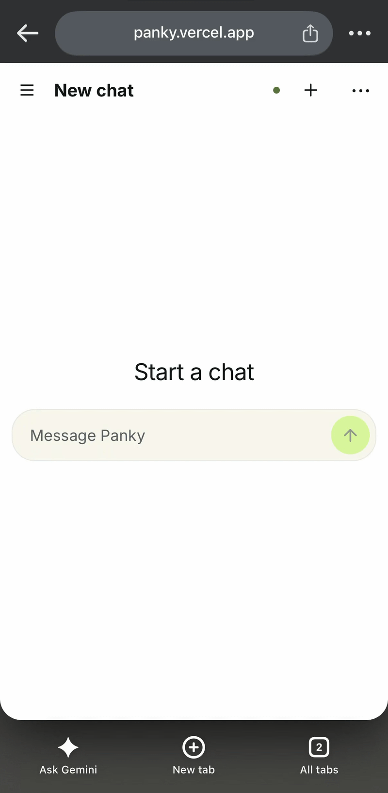

# panky

i spent a fortune on my graphics card, so i figured i should make it useful. Panky is a little AI teammate that runs on my PC and comes with me on my phone.

local models through Ollama, saved chats, and an interface built with [Pancake UI](https://github.com/j4ckwinter/pancake-ui).

try it at [panky.vercel.app](https://panky.vercel.app). it's invite-only for now.



## run locally

use Node 24+ and pnpm 12.16.1. from the repository root:

```sh
pnpm install --frozen-lockfile
cp -n apps/server/.env.example apps/server/.env
cp -n apps/web/.env.example apps/web/.env
node -e "console.log(require('node:crypto').randomBytes(32).toString('hex'))"
```

save the generated value as `AUTH_TOKEN` in `apps/server/.env`. keep it on the backend; browser login uses Google, not this token.

create a [Google OAuth web client](https://developers.google.com/identity/gsi/web/guides/get-google-api-clientid) with `http://localhost:5173` as an Authorized JavaScript origin, then set:

```dotenv
OWNER_EMAIL=your-email@gmail.com
GOOGLE_CLIENT_ID=YOUR_CLIENT_ID.apps.googleusercontent.com
AUTH_ORIGIN=http://localhost:5173
```

no client secret is needed. add your account as a Google test user if the OAuth app is in testing. leave the web proxy target at `http://127.0.0.1:3001`.

```sh
pnpm dev
```

if the production backend also runs on this PC, use separate development settings. put these in `apps/server/.env.development`:

```dotenv
AUTH_ORIGIN=http://localhost:5173
ALLOWED_ORIGINS=http://localhost:5173
PORT=3002
DATABASE_PATH=./data/panky-dev.sqlite
```

put `PANKY_API_TARGET=http://127.0.0.1:3002` in `apps/web/.env.development`. restart `pnpm dev` and open `http://localhost:5173`. these ignored overrides keep development on its own port and database; the production launcher still uses `.env` only. the Google client must allow `http://localhost:5173` as an authorized JavaScript origin.

open **http://localhost:5173** and sign in. the default mock model gives scripted replies without Ollama; chat storage and the clock tool work. try asking “What is the current date and time?”

the owner can invite people through **Account → People**. each person has private chats and can manage their devices under **Account → Sessions**.

## use a local model

on Windows, install Ollama and keep it bound to `127.0.0.1:11434`. set these in PowerShell, then quit and relaunch Ollama:

```powershell
[Environment]::SetEnvironmentVariable("OLLAMA_NO_CLOUD", "1", "User")
[Environment]::SetEnvironmentVariable("OLLAMA_GO_TEMPLATE", "1", "User")
ollama pull qwen3:4b-instruct-2507-q4_K_M
ollama create panky-qwen3:4b -f models/qwen3.Modelfile
```

run the model commands from the repository root after relaunching Ollama. the explicit Instruct model and [custom template](models/qwen3.Modelfile) are the evaluated configuration; rerun `pnpm evaluate:ollama --run` before changing them.

set these in `apps/server/.env`, then restart the backend:

```dotenv
MODEL_PROVIDER=ollama
MODEL_NAME=panky-qwen3:4b
MODEL_ENDPOINT=http://127.0.0.1:11434
MODEL_CONTEXT_LENGTH=4096
HISTORY_MAX_CHARS=8000
MAX_TASK_DURATION_MS=120000
```

the deployed frontend uses Vercel and an HTTPS tunnel to the PC backend. the PC, backend, Ollama and tunnel must stay running. keep Ollama's port private. deployment routing lives in [vercel.json](apps/web/vercel.json); set the backend's `AUTH_ORIGIN` and `ALLOWED_ORIGINS` to your exact frontend origin.

### start on Windows

with Ollama running and ngrok on your PATH, start the backend and tunnel from the repository root:

```powershell
.\scripts\start-panky.ps1
```

this uses the existing build. for the first run, or to pull the latest code, install dependencies and rebuild first:

```powershell
.\scripts\start-panky.ps1 -Update
```

the launcher uses `apps/server/.env`, expects the backend at `127.0.0.1:3001`, and starts the existing ngrok tunnel with inspection disabled. failed updates stop startup.

logs appear in the same terminal. wait for any reply to finish, then press **Ctrl+C** to stop the backend and tunnel. use Ctrl+C rather than closing the terminal; Ollama stays running.

## connect Notion

open **Connections** in the sidebar to link your own Notion workspace. each account has its own connection. choose pages to import, inspect their passages and refresh or remove the local copies.

the host needs to [configure Notion OAuth](docs/notion-connections.md) first. the existing owner-only imports in Interview keep working separately until explicitly re-imported through Connections. disconnecting removes that connection’s copies; saved conversations and evidence stay.

## development

- `apps/web` — React/Vite UI and API client.
- `apps/server` — authentication, model providers, chat execution and SQLite.
- `packages/shared` — API schemas and types.

```sh
pnpm check       # lint, formatting, types and backend tests
pnpm build       # build all packages
pnpm test:e2e    # browser tests against an isolated backend
pnpm format      # format source
```

install the test browser once with `pnpm exec playwright install chromium`. tests use isolated databases; real Google sign-in and deployment still need a live check.

one response runs at a time. interrupted replies are saved and never retried automatically. SQLite stores chats in plaintext: keep its directory private, and stop the backend before backing up the database and any sidecar files.

see the [server configuration](apps/server/.env.example), [web configuration](apps/web/.env.example) and [project brief](brief.md) for more detail.
