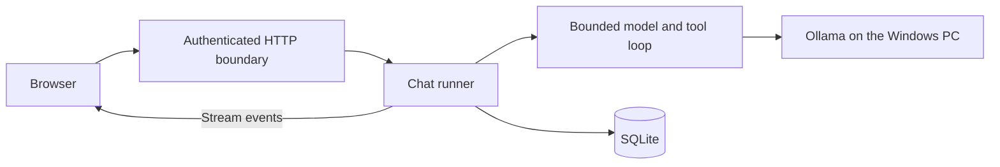

# Keeping a reply recoverable

Panky runs local models on a Windows PC while people use the interface from a desktop or phone. A browser can disconnect halfway through an answer, a model can return an invalid tool call, and another account can try to send a message while the PC is busy. The application needs to preserve what happened and make the next action clear.

## Follow one reply

The [server](../apps/server/src/http.ts) authenticates each chat request before handing it to the [chat HTTP handler](../apps/server/src/chat/http.ts). The handler validates the submission with shared schemas and checks conversation ownership. It rechecks access after asynchronous request parsing and provider selection, then passes named options to the [chat runner](../apps/server/src/chat/chat.ts).



The runner reserves the single response slot. A [SQLite transaction](../apps/server/src/chat/store.ts) creates the user message, assistant placeholder and task record together. Each model text chunk is saved before it is sent to the browser. The HTTP writer waits for the response buffer to drain when necessary.

If the connection closes, an abort signal reaches the model and any executing tool. The runner records a terminal task status and preserves partial text. Explicit cancellation is recorded separately from a lost connection or provider failure. The response slot remains occupied until execution and cleanup settle. On startup, unfinished persisted runs are marked interrupted.

The browser never automatically resubmits a message. When delivery ends without a completion event, it marks the visible reply interrupted and offers a history refresh. That refresh can reveal a completed answer if the server finished before delivery was lost. A draft is cleared only after the server accepts its submission; a draft for the next message survives recovery. The [client reducer](../apps/web/src/chat/chatState.ts) keeps related message and task transitions together.

## Keep execution and access bounded

The [execution loop](../apps/server/src/chat/loop.ts) validates provider events and tool arguments, rejects duplicate tool-call IDs, and limits model steps, output and context size. A deadline requests cancellation. Providers and tools must cooperate with abort; this is not a sandbox for arbitrary code.

Account checks cover history, submissions and task cancellation. Cookie-authenticated writes require the configured exact origin. A second account cannot cancel the active task just because the PC is busy. These rules apply independently of the browser's CORS checks.

## Tradeoffs

| Choice                            | Benefit                                                             | Cost                                                              |
| --------------------------------- | ------------------------------------------------------------------- | ----------------------------------------------------------------- |
| One response at a time            | One clear owner of local model execution and cancellation           | Other users wait; coordination is limited to one backend process  |
| Save partial output as it arrives | Refresh and restart recovery retain received text                   | More synchronous SQLite writes than saving only completed answers |
| Explicit refresh and resubmission | An uncertain connection does not silently repeat model or tool work | Recovery sometimes needs a user action                            |

The UI exposes these decisions with a stop control, interrupted-reply messages and preserved drafts. It also [preserves the reading position](../apps/web/src/chat/messages/useChatScroll.ts) during streaming, with a jump-to-latest action when someone scrolls back.

## Evidence and limits

[Backend tests](../apps/server/src/chat/task.test.ts) exercise cancellation during provider execution, cleanup retaining the response slot, duplicate tool calls and budget failures. [Account isolation tests](../apps/server/src/isolation.test.ts) exercise access across users. [Browser tests](../tests/chat.spec.ts) cover reload interruption and truncated delivery followed by recovery without resubmission; [task tests](../tests/tasks.spec.ts) check cancellation against the backend.

From the repository root:

```sh
pnpm check
pnpm build
pnpm test:e2e tests/chat.spec.ts tests/tasks.spec.ts tests/chat-improvements.spec.ts
```

These checks use isolated databases and controlled providers. They establish application behavior, not live model answer quality, real OAuth availability or multi-server scalability. The current design assumes one backend process and a PC that stays available.
